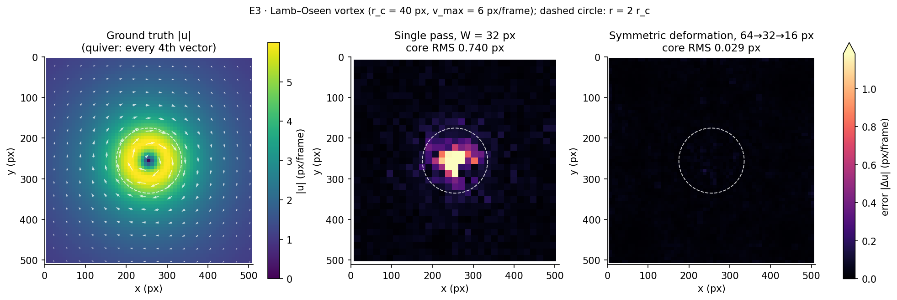
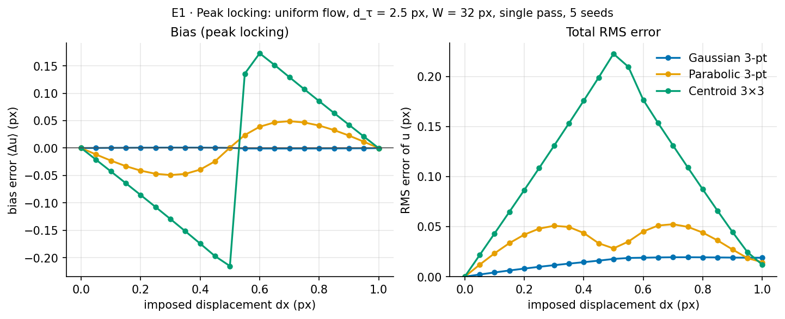
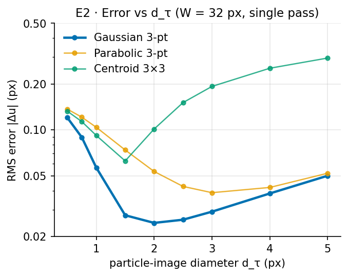

# piv-from-scratch

[](https://github.com/kurikennn/piv-from-scratch/actions/workflows/ci.yml)

A Particle Image Velocimetry processor written from scratch in plain NumPy/SciPy. It comes with a synthetic image generator that has a known ground truth, so every error below is **measured**, not estimated.



## Method

- **FFT cross-correlation** of mean-subtracted windows, vectorised over all windows at once, with the finite-window weighting (1 − |s_x|/W)(1 − |s_y|/W) divided out before the sub-pixel fit (Willert & Gharib 1991).
- **Three-point Gaussian sub-pixel fit**, separable in x and y. Parabolic and 3×3 centroid fits are also available; the code falls back to parabolic when a correlation value is ≤ 0, and counts each fallback.
- **Normalised median test** over 3×3 neighbours (ε = 0.1 px, threshold 2), with outliers replaced by the median of valid neighbours (Westerweel & Scarano 2005).
- **Symmetric window deformation:** A is warped by −½ the predictor and B by +½, with a binomial-filtered predictor and bicubic interpolation (Scarano 2002).
- **Multi-pass 64 → 32 → 16 px** at 50 % overlap, plus 2 iterations at 16 px, each pass validated.
- **Synthetic ground truth:** pixel-integrated (erf) Gaussian particles, advected along RK4 pathlines ±½ frame from mid-time, with 8-bit quantisation, noise and out-of-plane loss.

Every equation is written out in [docs/method.md](docs/method.md) and in the docstrings.

## Results

512 × 512 px images, N_ppp = 0.05, d_τ = 2.5 px, 8-bit, no noise unless stated. Errors are measured at interior vectors (≥ 32 px from the border). RMS includes bias.

| E1: uniform dx = 0…1 px, W = 32, single pass, 5 seeds | max \|bias\| (px) | max RMS (px) | mean RMS (px) |
|---|---:|---:|---:|
| Gaussian 3-pt | **0.0009** | **0.019** | 0.014 |
| Parabolic 3-pt | 0.049 | 0.052 | 0.035 |
| Centroid 3×3 | 0.215 | 0.223 | 0.106 |

| E3: Lamb–Oseen vortex (r_c = 40 px, v_max = 6 px/frame), 5 seeds | RMS, interior (px) | RMS, core r < 2r_c (px) |
|---|---:|---:|
| Single pass, W = 32 | 0.215 | 0.674 |
| Single pass, W = 16 | 0.165 | 0.370 |
| Deformation 64 → 32 (+2 it.) | 0.052 | 0.162 |
| **Deformation 64 → 32 → 16 (+2 it.)** | **0.020** | **0.027** |

Multi-pass deformation cuts the core RMS error by **25×** against a single pass at W = 32, and by 4.2× at the same final window size.

<p>


</p>

- **E2:** the Gaussian estimator's error is lowest at d_τ = 2 px (0.025 px). Below 1.5 px the peak is narrower than a pixel: at 0.5 px, 49 % of Gaussian fits fall back to parabolic, and the RMS error rises to 0.12 px.
- **E4** ([figure](figures/robustness.png)): noise up to 5 % of full scale leaves no vectors with error > 0.5 px, and RMS rises from 0.020 to 0.054 px. Low seeding is the real failure mode. At N_ppp = 0.005 (≈ 1.3 particles per 16² window), 9.3 % of vectors are wrong before validation and 1.1 % after.

All numbers are in [`results/`](results) (`summary.json` plus one CSV per experiment).

## Reproduce

```sh
nix run .#experiments   # regenerates results/*.csv and figures/*.png (~75 s)
nix flake check         # ruff + pytest (~5 s of tests)
```

`nix develop` gives a shell with Python 3.12, NumPy, SciPy, Matplotlib, pytest and ruff.

## Limitations

- Synthetic images only (Phase 1). The generator is idealised: no laser-sheet profile, no background, and no lens aberrations.
- 2D-2C only; no stereo or tomographic PIV.
- CPU only. A 512² image takes about 0.6 s for the full five-pass pipeline.
- The ground truth is the Eulerian u(x). In curved flow the particle chord differs from it by a small modelling error (~6·10⁻³ px at the vortex peak).

## Roadmap

- **Phase 2:** a WebGPU live demo on GitHub Pages, with WGSL compute-shader correlation, sliders for d_τ, N_ppp, noise, vortex strength and W, a live RMS readout, parity with Python to 1e-3 px, and a GPU vs NumPy throughput comparison.
- **Phase 3:** real images from a PIV Challenge case, per-vector uncertainty quantification compared with the true synthetic error, and a link to DAQ/calibration practice.

## References

- Raffel, Willert, Scarano, Kähler, Wereley & Kompenhans, *Particle Image Velocimetry: A Practical Guide*, 3rd ed., Springer, 2018.
- Willert & Gharib (1991), "Digital particle image velocimetry", *Exp. Fluids* 10.
- Scarano (2002), "Iterative image deformation methods in PIV", *Meas. Sci. Technol.* 13.
- Westerweel & Scarano (2005), "Universal outlier detection for PIV data", *Exp. Fluids* 39.

MIT licence. No code was copied or adapted from OpenPIV, PIVlab or other packages; OpenPIV is used only in an optional cross-check test.
